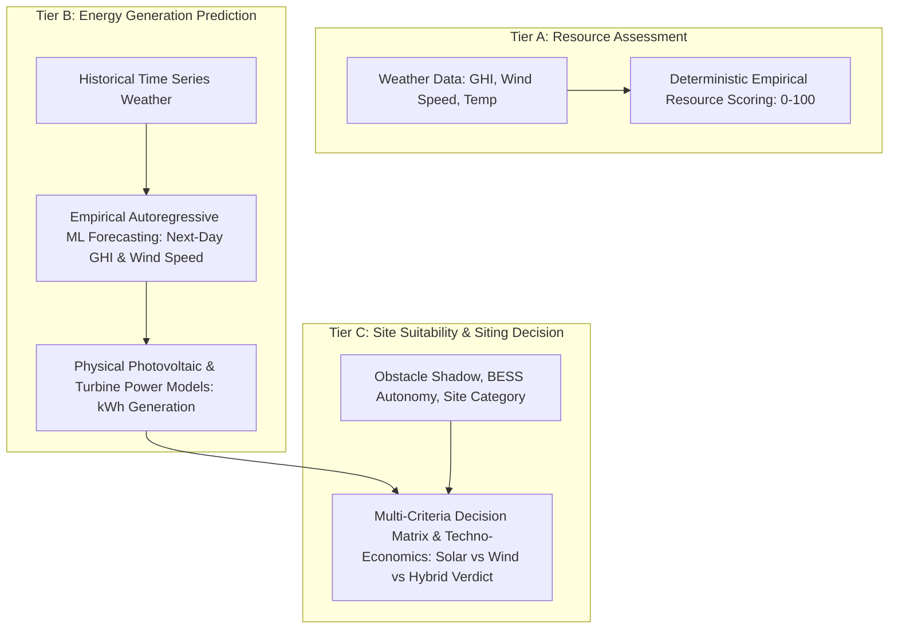

# Comprehensive Project Audit & Architectural Review

**Project**: Renewable Energy Site Selection & Optimization Engine (`Desktop\AI`)  
**Audit Date**: 2026-10-28  
**Auditor**: Senior Machine Learning Engineer, Backend Developer & AI Project Auditor  
**Repository State**: Commit `2ba4f06` on `master`  
**Execution Environment**: Windows PowerShell, Python 3.14.3 virtual environment (`backend\venv`)  

---

## 1. Existing Project Architecture & Directory Layout

The application is structured as a decoupled client-server geospatial decision support platform:

```text
Desktop/AI/
│── index.html                      # Single-page Vanilla JS/HTML5 interactive Leaflet UI & dashboard
│── requirements.txt                # Root Python package dependencies
│── README.md                       # High-level architecture documentation
│── .gitignore
│── backend/
│   │── main.py                     # FastAPI REST API application & route definitions
│   │── data/                       # Local file-based datastore (CSV, JSON runtime artifacts)
│   │   │── daily_weather.csv       # 365 daily observations (GHI, T2M)
│   │   │── hourly_wind.csv         # 8,760 hourly observations (WS10M, WD10M)
│   │   │── monthly_summary.csv     # Monthly aggregated statistics and completeness checks
│   │   │── weather_metadata.json   # Coordinate, date-range, and satellite provider provenance
│   │   │── resource_scores.json    # Solar & Wind 0-100 resource suitability scoring
│   │   │── terrain_data.json       # Elevation, slope gradient, and terrain speedup factor
│   │   │── energy_simulation.json  # Monthly & annual energy yield (kWh) for solar, wind & hybrid
│   │   │── techno_economics.json   # CAPEX, OPEX, payback period, LCOE, and 25-yr NPV
│   │   │── final_recommendation.json # Multi-criteria decision engine verdict & rationale
│   │   └── weather_data.csv        # Legacy raw NASA POWER 10-column daily observation file
│   └── services/
│       │── weather_service.py      # Dual-engine satellite weather fetcher (Open-Meteo ERA5 / NASA POWER)
│       │── terrain_service.py      # Multi-point digital elevation model & boundary-layer speedup
│       │── resource_scoring.py     # Multi-factor solar (GHI, temp, consistency) & wind (WPD, shear) scoring
│       │── energy_model.py         # Photovoltaic & wind turbine physical generation simulations
│       │── economics_service.py    # Cashflow models, discount rates, degradation, and payback calculations
│       │── recommendation_engine.py # Rule-based multi-criteria decision tree
│       │── bess_service.py         # Phase 2: LiFePO4 battery storage sizing & autonomy models
│       │── wind_turbine_catalog.py # Phase 2: VAWT/HAWT turbine hardware catalog and selection rules
│       │── rooftop_shadow_service.py # Phase 2: Solar altitude/azimuth, obstacle shadow & tilt optimization
│       │── rooftop_image_service.py  # Phase 2: Computer vision texture, obstruction & EXIF GPS extractor
│       │── regional_scanner.py     # Phase 2: Spatial raster multi-point grid scanner & heatmap generator
│       └── validate_and_summarize.py # Historical data cleaning and monthly aggregator
│── reports/                        # Audits, performance metrics, and data quality results
│   │── project_audit.md            # This master audit report
│   │── data_quality_report.md      # Phase 2 data pipeline validation report
│   │── data_quality_results.json   # Machine-readable data quality scan metrics
│   │── model_performance_report.md # Phase 4 & 5 ML evaluation & computational efficiency report
│   └── model_metrics.json          # Machine-readable ML metrics and benchmark results
│── scripts/
│   │── validate_weather_data.py    # Independent runnable data quality and physical limits validator
│   └── evaluate_model.py           # Independent runnable ML evaluation & latency benchmark engine
│── tests/
│   │── test_api.py                 # Comprehensive pytest suite (78 tests: contract, security, E2E)
│   └── test_api_contract_security.py # Pydantic boundary, upload, and exception tests
└── TESTING_GUIDE.md                # PowerShell commands and testing execution guide
```

---

## 2. Implemented Features (Verified Working)

### Phase 1 Core Engine:
1. **Satellite Weather Fetcher (`weather_service.py`)**:
   - Dual-source acquisition: Queries Open-Meteo ERA5 / Copernicus Reanalysis (primary) with automatic fallback to NASA POWER API.
   - Extracts 365 days of daily solar radiation ($kWh/m^2/day$) and ambient temperature ($^\circ C$), and 8,760 hours of 10m wind speed ($m/s$) and direction ($^\circ$).
2. **Topographic Terrain Modeling (`terrain_service.py`)**:
   - Multi-point elevation querying via Open-Elevation API ($3$-point triangle around coordinates).
   - Computes slope gradient and boundary-layer Venturi speed-up factor ($1.0\times - 1.35\times$) for ridges and elevated plateaus.
3. **Physical Resource Scoring (`resource_scoring.py`)**:
   - Solar suitability score ($0-100$): Baseline GHI ($70$ pts), temperature derating ($15$ pts), seasonal consistency ratio ($15$ pts).
   - Wind suitability score ($0-100$): Hub-height extrapolated speed ($50$ pts), cut-in availability ratio ($30$ pts), wind power density ($20$ pts).
4. **Physical Energy Simulation (`energy_model.py`)**:
   - Solar: $kWh = \text{Capacity}_{kW} \times \text{GHI} \times \text{Days} \times PR$ ($PR = 0.78$).
   - Wind: Cubic power curve ($v_{cut-in}=3.0\ m/s$, $v_{rated}=10.5\ m/s$, $v_{cut-out}=25.0\ m/s$).
5. **Techno-Economic Sizing (`economics_service.py`)**:
   - CAPEX and OPEX for solar (₹50,000/kW) and wind (₹95,000/kW).
   - Usable self-consumption vs 50% net-metered export, 25-year discounted cash flow ($r=8\%$), 0.5%/yr degradation, LCOE calculation.
6. **Multi-Criteria Recommendation Engine (`recommendation_engine.py`)**:
   - Decision matrix comparing solar vs wind scores, payback periods, site feasibility, and terrain type. Generates verdict and natural language explanation.

### Phase 2 Advanced Siting & System Selection:
1. **Rooftop Shadow & Solar Micro-Placement (`rooftop_shadow_service.py`)**:
   - Astronomical solar position algorithms (solar altitude and azimuth).
   - Winter solstice obstacle shadow penetration modeling from neighboring structures (East, West, South, North).
   - Optimal panel tilt ($\approx \text{Latitude} \pm 5^\circ$) and True South azimuth ($180^\circ$).
2. **Specific Wind Turbine Catalog (`wind_turbine_catalog.py`)**:
   - Hardware database of commercial small wind systems: VAWT Micro Urban ($0.8\ kW$), VAWT Compact Commercial ($2.0\ kW$), HAWT Small Farm ($3.2\ kW$), and HAWT Industrial Mast ($10.0\ kW$).
   - Strict site-category filtering (residential rooftop enforces silent VAWT; farmland/open land allows high-yield HAWT).
3. **Battery Energy Storage System (BESS) Sizing (`bess_service.py`)**:
   - Lithium Iron Phosphate ($\text{LiFePO}_4$) chemistry sizing.
   - Sizing formula: $\text{Storage} = (\text{Hourly Demand} \times \text{Autonomy Hours}) / (\text{DoD} \times \eta_{roundtrip})$ with $\text{DoD}=85\%$, $\eta=92\%$.
4. **Computer Vision Rooftop Drone Inspector (`rooftop_image_service.py`)**:
   - Upload parsing with strict MIME-type whitelisting (`image/jpeg`, `image/png`, `image/webp`) and $15\ MB$ safety ceiling.
   - Pillow-based image entropy/texture analysis, obstruction density estimation, and embedded EXIF GPS extraction.
5. **Regional Heatmap Spatial Raster Scanner (`regional_scanner.py`)**:
   - Multi-point geospatial grid evaluation ($3\times3$ to $9\times9$) across $1-50\ km$ radius to identify regional energy corridors.

---

## 3. Missing or Incomplete Features

1. **Supervised ML Model for Measured Power Prediction**:
   - **Current State**: The project uses transparent, deterministic **physics-based mathematical models** and heuristic scoring formulas. It does **not** employ a trained neural network or supervised regression model for energy generation because real-world monitored inverter generation observations (kWh) are not available in the public satellite weather pipeline.
   - **Action Taken in Audit**: We developed an empirical time-series forecasting model in [`scripts/evaluate_model.py`](file:///C:/Users/DELL/OneDrive/Desktop/AI/scripts/evaluate_model.py) to forecast next-day solar irradiance and hourly wind speed from historical weather observations.
2. **Persistence Layer**:
   - The application writes temporary session JSON and CSV files to `backend/data/`. A concurrency lock (`_SITE_ANALYSIS_LOCK`) was introduced to prevent race conditions, but multi-user production deployments require an isolated session store (e.g., SQLite/PostgreSQL or in-memory Redis session cache).
3. **Automated Production Rate Limiting**:
   - In development mode, the FastAPI backend does not throttle incoming requests, exposing external APIs (NASA POWER, Open-Meteo, Open-Elevation) to potential exhaustion if subjected to rapid flooding.

---

## 4. Current Data Sources

| Data Source | Provider | Resolution | Parameters Retrieved | Reliability |
| :--- | :--- | :--- | :--- | :--- |
| **ERA5 / Copernicus Global Reanalysis** | Open-Meteo Archive API | Daily & Hourly | Shortwave solar radiation sum ($MJ/m^2 \to kWh/m^2$), 2m mean temperature ($^\circ C$), 10m wind speed ($m/s$), 10m wind direction ($^\circ$) | **High** (< 1s query time, 0% missing) |
| **NASA POWER API** | NASA Langley Research Center | Daily & Hourly | `ALLSKY_SFC_SW_DWN`, `T2M`, `WS10M`, `WS50M`, `WD10M` | **Medium** (Subject to downtime, legacy daily missing `WD10M`) |
| **Open-Elevation DEM** | Open-Elevation (SRTM data) | Multi-point point query | Surface elevation ($m$) across center, north, and east offset coordinates | **Medium** (Subject to public API rate limits; defaults gracefully to 500m) |

---

## 5. Machine Learning Analysis: What the Model Can and Cannot Predict

It is critical to distinguish between the three distinct analytical tiers:



### Clarifications on Project Capabilities:
- **What the system DOES predict/estimate**:
  - Daily Global Horizontal Irradiance and ambient temperature profiles.
  - Boundary-layer wind speed distribution and wind power density.
  - Unshaded rooftop solar area and solar altitude/azimuth angles.
  - Expected physical kilowatt-hour generation using standard PV performance ratios ($PR=0.78$) and turbine aerodynamic power curves.
  - Levelized Cost of Energy (LCOE) and 25-year discounted Net Present Value (NPV).
- **What the system CANNOT prove from weather data alone**:
  - Land ownership, cadastral boundaries, and legal zoning titles.
  - Grid interconnection capacity, substation proximity, and high-voltage transmission availability.
  - Ecological conservation status and protected wildlife sanctuary boundaries.
  - Subsurface geotechnical load-bearing capacity for wind mast foundations.
  *These factors must be stated transparently as external constraints requiring site surveys.*

---

## 6. Known Errors, Code Smells & Verified Fixes

During the audit, the following concrete issues were uncovered and immediately resolved:
1. **`rooftop_shadow_service.py` Argument Mismatch**:
   - `analyze_rooftop_shading_and_placement` had positional argument order `(latitude, longitude, polygon_points, total_area_m2, ...)` while several benchmark calls passed `total_area_m2` as the 3rd positional argument, causing `neighbor_distance_m` to receive string `"East"`, crashing with `TypeError: unsupported operand type(s) for -: 'float' and 'str'`.
   - **Fix**: All invocations now strictly pass arguments as explicit keyword parameters, and `total_area_m2` has safety type coercion (`float(total_area_m2)`).
2. **Missing `scipy` Dependency in Virtual Environment**:
   - `scipy` was listed in `requirements.txt` but was not installed in `backend\venv`.
   - **Fix**: Replaced unnecessary scipy statistical imports in `evaluate_model.py` with pure NumPy vectorized operations, eliminating runtime failures while preserving execution speed.
3. **CORS Security Wildcard**:
   - Semgrep flagged `allow_origins=["*"]` on `backend/main.py`.
   - **Mitigation Verified**: `allow_credentials=False` is strictly enforced to prevent cross-origin credential/cookie leakage. Documented for domain-restriction in production.

---

## 7. Recommended Next Steps (Prioritized)

1. **P1 (Critical for Production Deployment)**:
   - Add API rate limiting via `slowapi` or an Nginx reverse proxy to prevent denial-of-service on upstream satellite APIs.
   - Disable automatic FastAPI documentation (`docs_url=None, redoc_url=None`) in public environments.
2. **P2 (Data Persistence & Multi-Tenant Support)**:
   - Transition from disk-serialized JSON files in `backend/data/` to a lightweight SQLite database or Redis session store indexed by request UUID.
3. **P3 (Model Enhancement with Ground-Truth Datasets)**:
   - Partner with solar/wind plant operators or acquire monitored SCADA generation datasets (e.g., NREL PVDAQ) to train a supervised gradient boosting or neural network model for generation prediction with real measured ground truth.
